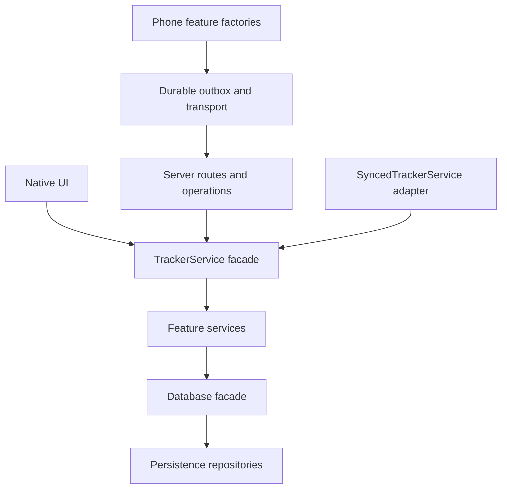

# Module boundaries and compatibility

Presentation and HTTP adapters call services. Services call pure core code and persistence. Sync adapts writes and mirrors; it does not own business rules. The server shares desktop services. The phone uses explicit ES modules without a framework or bundler.

## Imports

[check_boundaries.py](../../scripts/check_boundaries.py) rejects core imports of services/sync/UI/server/Qt, service imports of sync/UI/server/Qt, and server imports of native UI/Qt. `sync/qt_worker.py` is the named Qt adapter; other sync modules remain Qt-free. Features cannot import the phone composition shell. Eager Python and static JavaScript import cycles fail the check.

Python function-local imports are excluded from eager-cycle analysis, but remain subject to layer checks. Imported package initializers are included. The existing session-list/dialog lazy import prevents an eager cycle. `TYPE_CHECKING` imports have no runtime edge. JavaScript checks cover explicit imports/reexports and literal dynamic imports, ignoring comments and literal contents. Symbol references cover supported module declarations and named reexports, including their imported bindings. This check describes import structure, not dynamic execution or every possible callback dependency.

## Facades and state owners

`Database`, `TrackerService` and `SyncedTrackerService` retain their public import paths and method signatures. Extracted service components reference their TrackerService facade; repositories reference their Database facade. Shared state stays on those facades. Database owns one connection and transaction scope; TrackerService owns the active timer; SyncedTrackerService owns queue-aware write overrides.

[Generated delegation interfaces](../generated/interfaces.md) identify the extracted owners. Keep explicit delegation rather than dynamic attribute forwarding: reviewers and static indexes can see which method is responsible. Compatibility wrappers preserve existing private monkeypatch points, import paths and subclass dispatch while moving implementations underneath them.

Native [MainWindow](../../jobtracker/ui/app.py) retains Qt ownership, lifecycle and feature wiring. [KeyboardController](../../jobtracker/ui/controllers/keyboard.py) and [WindowSyncController](../../jobtracker/ui/controllers/sync.py) coordinate through its stable methods. Phone feature factories receive callbacks/state explicitly; request epochs, drafts, fullscreen DOM and refresh scheduling keep their original ownership.

The server shares one [runtime state and lock](../../server/runtime.py) and one [authentication dependency](../../server/dependencies.py). Routes never import the composition module back. All routers are included before the final static mount.

## Changing a feature

Run `python scripts/dev.py context weight.daily-entry` to find entry points, rule/persistence owners, contracts and focused checks. Update [features.json](features.json) with the same change when an owner moves. Run `python scripts/dev.py check`; regenerate the checked maps with `python scripts/dev.py check --write` when the source change intentionally changes them. Shared test helpers belong under [tests/support](../../tests/support/__init__.py), not in a collected test module.
