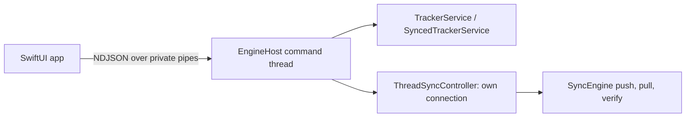

# Native engine host and local bridge

The native Mac frontend talks to one Python engine process. The engine reuses
the existing `Database`, `TrackerService`/`SyncedTrackerService` and `SyncEngine`
owners; Swift never becomes a second rule or database owner. This boundary is
local to one Mac. The server wire format, `/ops` and the outbox are unchanged.



## Launch and store selection

`python -m jobtracker.desktop --mode MODE [--db PATH]` ([entry point](../../jobtracker/desktop/__main__.py)).

| Mode | Store | Notes |
| --- | --- | --- |
| `production` | `~/Library/Application Support/JobTracker/jobtracker.db` | Installed data; only for the guarded production cutover |
| `development` | `<checkout>/data/jobtracker.db` | Refused by a frozen helper |
| `isolated` | explicit `--db *.db` | Refuses either real store; prototypes and tests |

[bootstrap.py](../../jobtracker/desktop/bootstrap.py) resolves the path and sets
`JOBTRACKER_DB_PATH` before anything imports `core.database`, whose eager
singleton then owns the selected store. The host reuses that singleton instead
of opening a second foreground connection.

## Single owner per store

[ownership.py](../../jobtracker/desktop/ownership.py) takes an exclusive `flock`
keyed by the canonical database path, under `~/Library/Caches/JobTracker/locks/`
(`JOBTRACKER_LOCK_DIR` overrides it for tests). The kernel drops the lock when
its process exits or crashes, so a leftover file is never a live owner. Both the
engine and `main.py` take it before constructing services or running recovery;
a second owner reports `store_in_use` and exits without touching data.

## Frames

One JSON object per line ([protocol.py](../../jobtracker/desktop/protocol.py)),
protocol version 1, at most 1 MiB per frame. Protocol output uses a private
duplicate of stdout; descriptor 1 is redirected to stderr so stray prints cannot
corrupt the stream. The engine sends `hello` first (instance ID, mode, store ID,
command list) or a single `fatal` frame before exiting.

```json
{"protocol_version":1,"kind":"command","request_id":"<uuid>","command":"session.shift","params":{"session_uid":"<uid>","seconds":900}}
{"protocol_version":1,"kind":"response","engine_instance":"<uuid>","request_id":"<uuid>","outcome":"applied","result":{...},"topics":["graphs","sessions","subjects"],"revision":7}
{"protocol_version":1,"kind":"event","engine_instance":"<uuid>","event":"changed","topics":["graphs","sessions","subjects"],"revision":7}
```

Events: `changed` (committed topics and revision, after the response),
`sync_status` (persistent status text and pending count). A restarted engine
publishes a new instance ID; clients discard responses/events from another
instance.

## Commands and outcomes

The [allowlist](../../jobtracker/desktop/commands.py) maps UIDs to local IDs and
calls the facade normally, so synced overrides keep queuing operations. There is
no generic attribute, SQL, evaluation or file command. The shared
[fixture](../../tests/contracts/desktop_bridge/commands.json) lists every command,
kind and topic set for the Python and Swift tests.

| Kind | Examples | Durability |
| --- | --- | --- |
| `read` | `subjects.list`, `timer.get`, `graphs.agenda`, `sessions.for_subject` (paginated) | No commit |
| `mutation` | `timer.start`, `session.shift`, `goal.complete`, `weight.upsert`, `backup.import` | Mutation, outbox entries and receipt in one `Database.atomic` |
| `action` | `sync.configure`, `backup.export`, `app.quit`, `app.foreground`, `recovery.dismiss` | Not receipt-backed; files are written to a temporary file and replaced |

| Outcome | Meaning |
| --- | --- |
| `applied` | Mutation and receipt committed |
| `replayed` | Same request ID and parameters already committed; saved result returned |
| `ok` | Read or action finished |
| `missing` | Addressed row no longer exists |
| `refused` | Existing service declined (domain rule); committed as a receipt |
| `invalid` | Malformed frame, parameters or unknown command; nothing committed |
| `conflict` | Request ID reused with different parameters or store |
| `storage_error` | Rolled back; runtime timer state re-read from surviving rows |
| `unavailable` | Engine is stopping |

A local save and server synchronization are separate facts: `applied` means the
change is durable on this Mac; `sync_status` reports whether it reached the server.

## Receipts

[receipts.py](../../jobtracker/desktop/receipts.py) adds the local table
`desktop_request_receipts` (request ID, command, SHA-256 fingerprint of command,
parameters and store ID, outcome, safe result). It is created additively by the
engine; when an existing store gains it, an online SQLite backup is written to
`backups/migrations/` first. It is not synced, exported or touched by mirror
replacement, and old builds ignore it. It is not a queue: nothing is replayed
from it. Retrying a request after an unknown outcome uses the same ID and parameters; the engine
then returns the saved result instead of applying a second change.

## Threads, scheduling and lifecycle

[EngineHost](../../jobtracker/desktop/host.py) runs commands, scheduled jobs and
sync completions on one thread that owns the foreground connection and timer. A
reader thread only frames stdin into a bounded inbox (backpressure). The
[Qt-free sync worker](../../jobtracker/sync/thread_worker.py) opens its own
connection inside its thread, runs one pass at a time, remembers a mid-pass
request and posts results back to the inbox.

| Trigger | Behaviour (same as the Qt window) |
| --- | --- |
| Launch | Recovery through the selected facade, due recurring goals, sync after 1.2 s |
| Every 60 s | Heartbeat unless a recovery decision is pending |
| Every 5 min, focus, quit | Sync request |
| New pending operation | Debounced push after 1.5 s; up to three follow-ups |
| Logical-day boundary | Recurring goal generation |
| `app.quit` | Refused while genuinely tracking; otherwise bounded sync wait, rotating JSON backup, exit |
| stdin EOF or SIGTERM | Stop accepting commands, let a sync pass settle (bounded), exit. No implicit stop or backup; the open session is recovered by the next owner |

The [sync status wording](../../jobtracker/sync/presentation.py) is shared with
the Qt window. Tests: [tests/desktop](../../tests/desktop/test_engine_commands.py).
