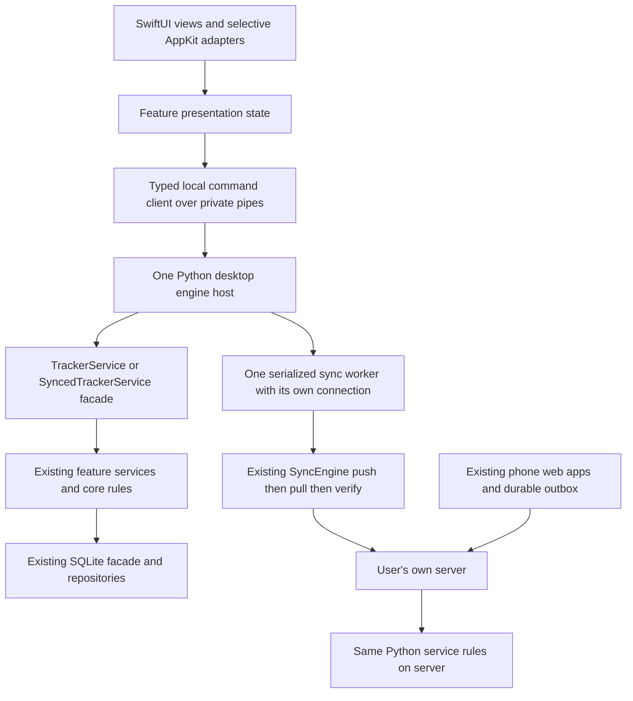

# A4 native Mac overhaul: complete implementation guide

Status: implementation in progress since 22 October 2026. The
[evidence record](a4-evidence.md) states which phases have actually run and
with what result; this guide still describes the complete target.

The user's direction is a strict improvement to the existing JobTracker:
retain its setup, data, workflows and recent fixes while improving the Mac
interface and its implementation. Build a SwiftUI frontend, use AppKit where
it gives better control, and retain the Python engine. Keep the phone apps
working and apply relevant visual and workflow improvements there too.

This is the execution guide for A4. The [earlier options](../proposals/ui-foundations-and-future-options.md)
and the separate Visual options v2 and Foundations PDFs remain review references.
Their unselected alternatives are not additional requirements. In particular,
this plan does not also introduce a QML frontend, a desktop web frontend,
aligned subject rows or a docked inspector.

## Contents

- [1. What must remain familiar](#1-what-must-remain-familiar)
- [2. Recent changes to preserve](#2-recent-changes-to-preserve)
- [3. Target architecture and explicit decisions](#3-target-architecture-and-explicit-decisions)
- [4. Repository owners and proposed additions](#4-repository-owners-and-proposed-additions)
- [5. Ordered implementation steps](#5-ordered-implementation-steps)
- [6. Feature and regression acceptance matrix](#6-feature-and-regression-acceptance-matrix)
- [7. Failure and recovery acceptance matrix](#7-failure-and-recovery-acceptance-matrix)
- [8. Verification commands and evidence](#8-verification-commands-and-evidence)
- [9. Release rollback and completion](#9-release-rollback-and-completion)
- [10. Platform references](#10-platform-references)

## 1. What must remain familiar

### Product and interaction contract

| Area | Preserve | Improve |
| --- | --- | --- |
| Overall app | JobTracker name and Cutout J icon; Goals, Subjects, Graphs, Weight in that order; existing sidebar, slim timer/status area and broadly full-width content | Consistent typography, spacing, controls, focus and rendering |
| Subjects | Separate cards, subject order and colours, notes, totals/filtering, tracking, Resume, archive/history and deletion safeguards | S1 calm cards with quiet borders, clear text actions and stable alignment |
| Goals | Independent outcome goals, milestones, completed/reopen view, weekly focus, recurrence and existing ordering | Keep number shortcuts reliable and present progress/actions consistently |
| Sessions | Existing exact sessions, timestamps, duration, identity and entry points; add/edit/delete/duplicate/move | W1: one consistent panel, visible presets and explicit selection everywhere |
| Tracking graphs | Stacked Bar and Agenda, current ranges/grouping/hours, logical days, future history and day/session access | R1 soft bloom; retain scaled, unboxed hour totals; selected Bold agenda finish |
| Weight | Two-row entry tiles, calendar dates, imported precision, historical edits, trends, deltas, ranges and fullscreen | Native presentation using the same weight and trend rules |
| Appearance | Existing named themes, legacy appearance choices, subject colours and animated backgrounds | F1 shared visual roles; compact subject colour selection; crisp vector controls |
| Updates | Local reads, offline writes, own-server sync, visible pending/error feedback, existing credentials | F2 affected-view updates that preserve focus, selection, scroll and drafts |
| Phone | Current Weight and JobTracker installation identities, profiles, navigation, offline queues and separate preferences | Matching selected components and session/chart behaviour where applicable |

Do not turn the redesign into a new product. Keep Goals separate from timed
Subjects. Keep the familiar cards rather than switching to the S2 table-like
layout. Do not add a dashboard, a KPI strip, new accounts, telemetry, hosted
dependencies, a heatmap, general undo history or session notes.

The selected visual work is **F1 + F2 + S1 + W1 + R1 + Bold agenda**, with all
existing named appearance options retained. These are implementation decisions,
not choices the user must make again at each stage.

### Data and compatibility contract

1. Preserve existing databases, row UIDs, session ownership, ordered outboxes,
   credentials, backup formats and local preferences. No re-enrollment or clean
   installation should be needed for the normal migration.
2. Keep `Database`, `TrackerService`, `SyncedTrackerService` and the existing
   `MainWindow` compatibility imports, signatures and documented override seams.
   Keep `python main.py` working throughout the transition.
3. Core and services remain Qt-free. The server continues to use the same Python
   services. Swift does not become a second business-rule or database owner.
4. Tracking keeps naive local ISO timestamps, wall-clock durations and the
   configured logical-day boundary, normally 03:00. Weeks start Monday. Weight
   continues to use calendar dates. No timezone conversion is part of A4.
5. Preserve intentional future, overlapping and long sessions. The design
   examples use non-overlapping blocks; that is not permission to reject or
   rearrange existing history. Moving a selected session is an explicit action.
6. Never silently delete unfinished sessions. Automatic recovery remains scoped
   to the owning device; server startup never performs desktop recovery.
7. Desktop synced mutations and outbox entries commit atomically. Push precedes
   pull and verification; mirror replacement requires an empty outbox.
8. Only the user's own server receives application data. A native Mac interface
   must work with that server unreachable and with sync switched off entirely.

Read the [engineering rules](../engineering-rules.md),
[boundaries](../architecture/boundaries.md), [time model](../architecture/time-model.md)
and [write path](../architecture/write-path.md) before implementing these seams.

## 2. Recent changes to preserve

The source baseline for this guide is `c7575b1`. The latest application-code
change is `925389c`; subsequent commits document the design review. Recheck the
actual HEAD when implementation begins. An old commit is a reference, not a
reason to discard later work.

| Change already present | Reference commit | Required native behaviour |
| --- | --- | --- |
| Resume follows actual timer history | `b60976c` | Use `get_last_tracked_subject`; never use the first subject or card order |
| Unified, previewable appearance choices | `3324f69`, building on `4952e23` | One complete-theme selector; complete live preview; Save persists; Cancel/Escape restores everything |
| Session presets always visible | `0040ac3` | Duration/custom and whole-session move controls need no disclosure button |
| Correct page focus and Goals-only numbers | `acfbecb` | Arrow page navigation tracks selection; digits open the exact Goal; nested milestone digits work; no background control gains focus |
| Proportional, finished chart stacks | `73d3e0c` | Correct heights, contiguous subject segments, rounded outer silhouette and gentle surface shading |
| Matching phone quick-add durations | `fb00621` | 15m, 30m, 1h, 1h 15m, 1h 30m, 2h and Custom |
| Restored hour hierarchy and glow | `925389c` | No label boxes; continuous size scaling; coloured halo; strongest red emphasis above 10h |
| Deterministic analytics test clock | `c46e393` | Reuse fixed-clock fixtures; do not reintroduce calendar-dependent tests |
| Half-window usability | `7f45852` | Trailing actions and editors remain reachable in narrow Mac windows |
| Weight fullscreen and deltas | `15f28c0`, `b4ed2c7` | Preserve fullscreen/drafts and eligible thirty-day comparison rules |
| Current desktop composition and icon | `80614a0`, `07f9b6a` | Keep sidebar, slim timer area, familiar page composition and Cutout J identity |
| Phone surfaces, trend and fullscreen improvements | `ff18358`, `a11d473`, `0022423` | Preserve existing phone options, gestures, chart ranges and fullscreen header behaviour |
| Explicit phone products and full-height shell | `3bde0de`, `5d8cc3b`, `ffc0b0c` | Preserve profile identity/storage, fixed frame, opaque status bar and pinch/reflow fixes |

The **Bold agenda, S1, W1 consolidation, R1 blurred bloom and F1/F2 extensions
are selected work still to implement**, not completed changes. Existing always-
visible presets and shared session actions are their starting point.

The compact subject colour picker is also remaining work. Recommended scope:
one compact set of the eight existing preset hues, with the current/custom colour
and a Custom action. Avoid a second duplicate bank of suggestions. Preserve
every saved colour exactly; compact selection must not recolour existing subjects
or remove themes.

## 3. Target architecture and explicit decisions

### Process and responsibility layout



**Recommended local transport:** a bundled child engine started by the native
application using Foundation `Process`, with a pipe in each direction. Use
versioned newline-delimited JSON messages. This is a proposed implementation
decision, not an existing interface. Keep protocol output on stdout and diagnostics
on stderr. No local HTTP listener, open port or new authentication system is
needed for this first implementation. See Apple's [Process](https://developer.apple.com/documentation/foundation/process)
and [Pipe](https://developer.apple.com/documentation/foundation/pipe) documentation.

Run service commands on one engine-owner thread. Its `Database` instance owns
its connection and atomic scope, and its `TrackerService` owns the active timer.
The existing sync worker already needs **a separate connection on its own
thread**, with WAL and busy timeout. Preserve that model: one connection per
owner/thread, not one shared SQLite connection passed between threads. A single
mutation must never span independently committed connections.

The native client owns UI state, not a second durable sync queue. The Python
helper owns desktop scheduling, heartbeat, existing credentials and networking.
The Swift process may animate an elapsed-time display from an engine snapshot;
it must not independently start/stop sessions or define timer policy.

### Decisions to make once, early

| Topic | Recommended decision | Validation needed |
| --- | --- | --- |
| Scope | Native Mac frontend over retained Python engine | Prove one read-only screen and one isolated write before migrating all screens |
| macOS minimum | Preserve the documented macOS 12 minimum | Use compatible views/state APIs or availability-checked fallbacks |
| Swift state | Use `ObservableObject`/explicit feature stores as the compatible baseline | Do not require macOS 14 Observation merely for convenience |
| Navigation | One window and explicit page selection; compatible sidebar implementation | Newer `NavigationSplitView` requires a macOS 12 fallback |
| Custom charts | Start with a native drawing view/Canvas plus accessible controls | Exact chart meaning, hit testing, text scaling and rendering matter more than a chart library |
| IPC | Child process and bounded JSON frames over private pipes | Framing, backpressure, launch failure, EOF and protocol mismatch tests |
| Local mutation retry | Durable request receipts at the Python boundary | Mutation, existing remote outbox entry and local receipt must share one atomic scope |
| Schema | Keep current tables and model formats; only necessary additive local bookkeeping | Compatibility with current Qt build, backup export/import and mirror replacement |
| Distribution | Preserve the current local signed-app workflow and data paths | Extend guarded build/install tooling; no App Store or sandbox conversion is bundled into A4 |
| Frontend rollout | Isolated native prototype, then separate native pilot, then default switch | Current Qt launch remains available through transition; two engines never own the same store |
| Phone | Retain plain ES modules and existing outbox | Share roles/fixtures and selected behaviour; keep platform-specific rendering |

SwiftUI does not automatically supply the selected design, performance or correct
focus behaviour. AppKit wrappers are acceptable for precise text input, focus,
window lifecycle and drawing. Keep them small and feature-specific.

### Example local command and commit sequence

The following is an **illustrative new local protocol**, not a server request or
an interface already implemented. Final field names are established in P03 and
then checked by shared fixtures:

```json
{
  "protocol_version": 1,
  "kind": "command",
  "request_id": "aaaaaaaa-aaaa-4aaa-8aaa-aaaaaaaaaaaa",
  "command": "shift_session",
  "params": {
    "session_uid": "bbbbbbbb-bbbb-4bbb-8bbb-bbbbbbbbbbbb",
    "seconds": 900
  }
}
```

The complete path for that +15m action is:

1. The view captures its selected UID and parameters. The native client keeps
   the unresolved request envelope privately before transmission so a crash
   cannot lose its retry identity. This record is not a second remote outbox.
2. The engine validates the allowlisted command and begins the outer atomic
   scope. It checks the request ID/parameter binding inside that scope.
3. If a receipt already exists, it returns that saved outcome without calling
   `shift_session` again. Otherwise it resolves the UID and calls the injected
   facade, preserving `SyncedTrackerService` override dispatch when enabled.
4. The existing mutation and existing sync-outbox enqueue, if applicable, run
   on the same foreground connection. The local receipt is stored before the
   outer commit. Any failure rolls back the whole action and re-adopts runtime
   timer state as needed.
5. Only after commit does the engine acknowledge the result and invalidate
   affected presentation topics. The native client resolves its local envelope
   and refreshes the selected record without losing unrelated field drafts.
6. Separately, the sync worker pushes the existing queued operation through
   server `/ops`, then pulls and verifies. The UI can truthfully show a locally
   saved move while the server remains unreachable.

This gives a concrete rule for lost replies: **retry the same request, never
apply another +15m shift with a newly minted ID to compensate for uncertainty**.

The current environment probe found Command Line Tools selected and a working
Swift compiler; `xcodebuild -version` failed because full Xcode was not selected.
Full Xcode availability is an implementation preflight item, not a blocker to
writing this guide. Do not silently install software, change the system developer
directory or raise the app's minimum OS to bypass it. A build-specific
`DEVELOPER_DIR` can select an existing Xcode without changing global selection.

### Strict improvement means observable evidence

The migration is ready only when preserved behaviours pass, selected designs
appear in working screens, and measured usability/performance meet the agreed
baseline. Passing service tests alone does not establish native UI parity.

Use these initial performance budgets as **proposed acceptance targets, not
measurements already achieved**: immediate pending feedback within 100ms of a
local click; no synchronous bridge wait on the UI thread; no rebuild of an open
form on a timer tick; smooth scrolling on the target Mac; inactive animated
backgrounds paused. Record cold/warm launch, peak memory, idle CPU, chart layout
and save-to-visible latency against the current app on identical synthetic data.
Investigate a repeatable regression over 10% in launch or memory before switching
defaults; report absolute values and whether the difference exceeds measurement
noise. A toolkit change is not evidence that those metrics improved.

## 4. Repository owners and proposed additions

These links identify **existing** owners. Use `python3 scripts/dev.py context
FEATURE_ID` for the current exact files and focused checks before editing.

| Concern | Existing owners to preserve/reuse |
| --- | --- |
| Startup and identity | [main.py](../../main.py), [config](../../jobtracker/core/config.py), [MainWindow](../../jobtracker/ui/app.py) |
| Subjects/timer | [TrackerService](../../jobtracker/services/tracker_service.py), [SubjectService](../../jobtracker/services/subject_service.py), [TimerService](../../jobtracker/services/timer_service.py) |
| Sessions | [SessionService](../../jobtracker/services/session_service.py), [shared session actions](../../jobtracker/ui/widgets/session_list.py), [editor](../../jobtracker/ui/widgets/session_dialog.py), [subject history](../../jobtracker/ui/widgets/manage_sessions_dialog.py), [day history](../../jobtracker/ui/widgets/day_sessions_dialog.py) |
| Goals/templates | [GoalService](../../jobtracker/services/goal_service.py), [RecurrenceService](../../jobtracker/services/recurrence_service.py), [goal panel](../../jobtracker/ui/widgets/goal_dialog.py) |
| Tracking charts | [analytics](../../jobtracker/services/analytics_service.py), [graph composition](../../jobtracker/ui/graphs_mixin.py), [bars](../../jobtracker/ui/widgets/graphs_view.py), [agenda](../../jobtracker/ui/widgets/agenda_view.py), [time rules](../../jobtracker/core/timeutils.py) |
| Weight | [feature guide](../features/weight.md), [WeightService](../../jobtracker/services/weight_service.py), [plot rules](../../jobtracker/core/weight_plot.py), [WeightView](../../jobtracker/ui/widgets/weight_view.py) |
| Appearance/input | [themes](../../jobtracker/core/themes.py), [styles](../../jobtracker/ui/styles.py), [settings](../../jobtracker/ui/widgets/settings_dialog.py), [keyboard](../../jobtracker/ui/controllers/keyboard.py), [inline panels](../../jobtracker/ui/widgets/dialog_utils.py) |
| Sync/lifecycle | [queue-aware facade](../../jobtracker/sync/service.py), [engine](../../jobtracker/sync/engine.py), [Qt worker adapter](../../jobtracker/sync/qt_worker.py), [window sync controller](../../jobtracker/ui/controllers/sync.py) |
| Storage/backup | [Database](../../jobtracker/core/database.py), [schema](../../jobtracker/core/persistence/schema.py), [backup codec](../../jobtracker/core/persistence/backup.py), [automatic backup](../../jobtracker/core/auto_backup.py) |
| Phone | [composition](../../web/app.js), [feature modules](../../web/features), [data layer](../../web/data), [shared UI](../../web/shared), [worker](../../web/sw.js) |
| Release/checks | [developer CLI](../../scripts/dev.py), [build](../../scripts/build_macos.py), [installer](../../scripts/install_macos.py), [feature registry](../architecture/features.json), [contracts](../architecture/contracts.json) |

The additions as implemented (see the [evidence record](a4-evidence.md)):

```text
native/macos/                    SwiftPM package (Command Line Tools suffice)
  Sources/JobTrackerKit/         shell, features, AppKit adapters, bridge client
  Sources/JobTracker/            app entry point
  Sources/JobTrackerChecks/      macro-free checks: decoding, layouts, live engine, feature state
jobtracker/desktop/              Qt-free engine host and local command adapter
tests/desktop/                  protocol, receipt, lifecycle and concurrency tests
tests/contracts/desktop_bridge/ shared command fixture and live sample responses
design/ui_roles.json             semantic type/spacing/surface/action roles
scripts/generate_ui_tokens.py    checked generation for Swift and phone CSS roles
scripts/build_native.py          signed bundle with the frozen engine (`dev.py build --native`)
```

Native UI automation (XCUIAutomation) still needs full Xcode; it is not part
of the current toolchain and remains a manual gate.

Keep existing palette definitions in `core/themes.py` as the colour authority.
Generate native theme data from those definitions plus the UI role data; do not
maintain independently edited Swift, CSS and Python palette copies. Preserve
the current `get_tokens` facade and storage keys. Build-time generation must
not import an eager database singleton or add a runtime web toolchain.

## 5. Ordered implementation steps

Each phase has individual steps, a concrete output and a validation gate. A
gate means required evidence, not an extra user permission request. Continue
autonomously through routine implementation choices within the selected scope.
The user has requested the guide first; none of these implementation steps is
being executed merely by writing it.

### P00 — Capture the baseline and establish parity

1. **P00.1 — Record the starting source.** Save HEAD, worktree status and current
   feature ownership. Preserve unrelated changes, including the existing
   untracked redesign folder. Use small local commits for later implementation;
   never push or rewrite history without an instruction.
2. **P00.2 — Inventory screens and commands.** Walk every page, setting, context
   menu, nested panel and keyboard action. Record each entry point and service
   method using the feature index; include backup/restore, recurrence, sync and
   weight options rather than inventorying only attractive screens.
3. **P00.3 — Record the existing setup.** Capture app identity, supported macOS
   minimum/architectures, data-directory selection, settings keys, token location,
   backup path, launch/quit/recovery behaviour and installer process matching.
   Store personal evidence only in ignored local files.
4. **P00.4 — Build synthetic comparison data.** Include long names, archived
   subjects, reordered goals, three milestones, all six themes, empty history,
   active/foreign timers, dense sessions, future and overlapping sessions,
   fractional timestamps and weight imports. Use fixed clocks and stable test UIDs.
5. **P00.5 — Capture visual and interaction baselines.** Render current pages at
   1x/2x, fullscreen and half-width; record keyboard/focus and draft behaviour.
   Include hour examples at 5.0, 7.9 and above 10 hours, not just identical bars.
6. **P00.6 — Establish test/performance baselines.** Run the existing checks on
   isolated databases. Record actual pass/skip/failure counts and local timing/
   resource measurements. Preserve unrelated known failures explicitly rather
   than treating them as new requirements or silently disabling tests.

**Output/gate:** a current behaviour inventory and repeatable synthetic baseline.
Every preserved feature has an acceptance row and an owner before replacement.

### P01 — Establish F1 and a native component reference

1. **P01.1 — Define semantic roles.** Specify body, secondary, heading, duration
   and chart-total typography; spacing, radii, borders, surfaces and action roles.
   Use platform system-font APIs and measured metrics, not unavailable named
   font families or fixed raster screenshots as controls.
2. **P01.2 — Preserve the six named themes.** Export OLED Midnight, Carbon Dark,
   Ocean, Slate, Ocean Aura and Violet Space. Preserve an unmatched legacy
   FX/palette pair as the current appearance rather than silently mapping it.
3. **P01.3 — Implement shared components.** Create Primary, Secondary, Quiet and
   Destructive actions; fields, compact selectors, status, card, milestone and
   panel primitives. Define normal, hover, focused, pressed, disabled and selected
   states with stable geometry and explicit accessible names.
4. **P01.4 — Build the S1 reference card.** Keep distinct subject blocks and
   colour markers with neutral text and quiet actions. Maintain readable row
   density and trailing controls in half-width windows. Keep the current roughly
   68px subject/56px minimum goal density as a comparison, allowing required reflow.
5. **P01.5 — Draw real vector icons.** Use appropriate system symbols or native
   vector paths with consistent weight and alignment. Retain the branded app icon.
   Do not upscale small bitmap controls to claim higher resolution.
6. **P01.6 — Simplify subject colour selection.** Implement the compact eight-hue
   preset set and Custom action described above. Keep current/custom colour
   visible and accessible; suggestions use active colours and do not add another
   oversized bank. Cancelling leaves the saved colour untouched.
7. **P01.7 — Generate and inspect the reference gallery.** Produce actual native
   components in all theme/state combinations, with narrow/wide and text-scale
   examples. Store synthetic before/after evidence. Use the selected design as
   the reference, without re-opening rejected layout alternatives.

**Output/gate:** shared visual components and generated tokens render correctly
before feature screens acquire individual styling. This is F1's first delivery.

### P02 — Create a Qt-free desktop engine host

1. **P02.1 — Audit startup imports.** Separate engine bootstrap from `QApplication`
   and `MainWindow`. Set the database mode/path before importing modules that
   instantiate the compatibility database. A helper must never fall into the
   development database because it lives inside a differently frozen bundle.
   Account for `database.py`'s eager `db = Database()` singleton: deliberately
   reuse its owned connection or introduce a compatibility-preserving lazy seam;
   injecting a second Database must not accidentally leave two foreground owners.
2. **P02.2 — Make launch mode explicit.** Source development, packaged production
   and isolated test/prototype modes must resolve the intended existing paths.
   Tests require an explicit temporary path. The prototype must never default to
   either real store. Keep credentials and paths out of committed launch fixtures.
3. **P02.3 — Enforce one desktop engine per store.** Add a process-lifetime lock
   keyed by the canonical database path before service construction or recovery.
   The Qt and native entry paths must both respect it. A second launch should
   activate the existing app or explain the conflict, never start another timer
   owner. A lock file alone must not count as a live lock after a crash.
4. **P02.4 — Reuse the service facade.** Construct one injected Database and the
   appropriate TrackerService/SyncedTrackerService for the owning engine.
   Preserve device identity and recovery semantics. Non-owning tools/read
   adapters use the non-recovering path and must not mutate data on inspection.
5. **P02.5 — Extract scheduling from Qt adapters.** Implement engine-owned
   heartbeat, sync scheduling and lifecycle callbacks without importing Qt.
   Preserve launch/focus/five-minute/quit triggers, debounced new-write pushes,
   one sync pass at a time and bounded follow-ups. Reuse SyncEngine rather than
   creating a new replication implementation.
6. **P02.6 — Preserve thread/connection ownership.** Open the sync worker's
   connection inside that worker. Send completion messages to the engine thread;
   never use its foreground connection from pipe-reader or worker callbacks.
   Keep transactions short and network requests outside UI/foreground commands.
7. **P02.7 — Define shutdown and owner-loss behaviour.** Normal quit follows the
   current confirmation/stop/backup semantics and bounded sync wait. Unexpected
   parent EOF must preserve the unfinished session, retain durable queued writes,
   stop accepting commands and let in-flight owned work settle before exit.
   Do not turn a broken UI connection into an implicit stop or repeated recovery.
8. **P02.8 — Verify headless lifecycle.** Test startup, duplicate launch, owner
   crash, foreign-device timer, blocked worker and clean quit against temporary
   stores. Prove headless startup imports no Qt and server startup is unchanged.

**Output/gate:** a small engine host using the existing rule owners. No new UI
can mutate data until single-owner, path, recovery and shutdown checks pass.

### P03 — Specify and implement the local command boundary

1. **P03.1 — Define versioned messages.** Specify protocol version, message kind,
   request ID, command, parameters, engine instance ID, response outcome and
   committed change topics. Use an initial capability handshake; incompatible
   helpers fail visibly before mutations. Keep the server wire format unchanged.
2. **P03.2 — Specify typed DTOs.** Define subjects, goals/milestones/templates,
   sessions, timer, graph data, weight, settings and sync-status shapes. Use stable
   UIDs across the boundary, explicit nullable fields and exact timestamp strings.
   Map UIDs to service-local integer IDs inside the Python adapter. Preserve
   untouched endpoint precision and imported weight precision. Do not decode
   naive local timestamps through a UTC-assuming Swift ISO-date strategy. Keep
   original strings and delegate canonical time calculations to Python.
3. **P03.3 — Use an explicit command allowlist.** Route commands to injected
   service methods through normal facade dispatch. Do not expose arbitrary
   attribute lookup, SQL, Python evaluation or filesystem execution. Keep backup
   destinations user-selected and scoped to the existing export/import use cases.
4. **P03.4 — Define errors and outcomes.** Distinguish applied, replayed,
   missing/deleted target, domain refusal, invalid input, storage failure,
   engine unavailable and unresolved request. Keep domain meaning and message
   consistent with existing services; never translate every false result into
   success or a transport error. A local durable save and server synchronization
   are separate status facts. Classify read, database-mutation, file-configuration
   and export commands explicitly: a SQLite transaction cannot atomically commit
   an arbitrary filesystem change. Backup import remains a database mutation;
   export and token-file replacement need their own recoverable file workflow.
5. **P03.5 — Implement atomic local receipts.** Give each database-backed mutation
   a stable request ID and bind it to its canonical command/parameters and store identity.
   Check an existing receipt before calling the service; reject changed parameters
   for an existing ID. Commit the domain mutation, any existing remote outbox
   entries and the local receipt in one outer `Database.atomic()` scope. In
   pure-local mode the same receipt protects the mutation without an outbox.
6. **P03.6 — Handle memory and ambiguous outcomes.** If the outer transaction
   fails, restore timer/runtime state from the surviving rows before answering.
   If the commit succeeds but the pipe reply is lost, look up/retry the same
   request ID. Never create a fresh add/duplicate request merely because a timeout
   occurred. Do not call a request cancelled once its mutation may have committed.
7. **P03.7 — Keep receipts local and durable.** Add necessary bookkeeping through
   a tested additive schema change. Specify its exclusion from synced tables,
   backup-domain payloads and replaceable mirror contents. Retain receipts through
   ordinary resync/engine restart; do not expire them while a client can still
   retry. Local receipts are not another pending-write outbox. A snapshot or
   receipt must not expose secret configuration values. Before any live schema
   migration, take SQLite online backups of every affected existing store and
   rehearse against copies. Prefer a local bookkeeping table over changing
   existing model columns; preserve old-build read compatibility explicitly.
   Store request parameter fingerprints and safe outcomes, not raw tokens. Do
   not persist secret-bearing configuration requests in the general native JSON
   request journal.
8. **P03.8 — Bound and harden transport.** Drain stdout and stderr asynchronously,
   bound message size and outstanding requests, escape strings as JSON, handle
   partial/multiple frames and apply backpressure. Paginate/chunk large history
   responses. Publish a new engine-instance ID after restart and reject stale
   responses/events. Log diagnostic identifiers without tokens or private content.
9. **P03.9 — Prove contract compatibility.** Share synthetic request/result fixtures
   between Python and Swift decoders. Test rollback at mutation/outbox/receipt
   boundaries, reply loss after commit, duplicate concurrent submission, UID
   lookup after resync and mismatched protocol versions. Keep these tests
   independent of the actual user databases and server.

**Output/gate:** a narrow, documented boundary that supports reliable local
writes without bypassing the existing service/outbox or creating duplicate work.

### P04 — Build the first read-only native view

1. **P04.1 — Establish the native build.** Verify full Xcode and select it for
   build commands as appropriate. Create a macOS application and test targets
   with a deployment target that preserves macOS 12. Keep dependencies limited
   to Apple frameworks and the bundled existing engine.
2. **P04.2 — Build the familiar shell.** Reproduce the page order, sidebar,
   settings access, sync status and slim timer/status region. The prototype uses
   synthetic data and clearly separate test identity/storage so it cannot appear
   to control the real running timer.
3. **P04.3 — Connect a read-only Subjects model.** Decode engine fixtures, then
   query a disposable store through the helper. Render S1 cards and existing
   tracked totals/filter options. Keep mutation commands disabled at this stage.
4. **P04.4 — Implement real selection and focus.** Use explicit selected-page
   state and native focus handling. Left/Right changes pages when navigation owns
   input; text fields and panels retain their keys. Remove numeric sidebar and
   subject affordances. Hover must not claim keyboard selection.
5. **P04.5 — Check window behaviour.** Resize, fullscreen, exit fullscreen,
   minimize, reopen and move across displays. Verify light/dark system context
   does not replace the chosen application theme or wash out the cards.
6. **P04.6 — Compare the working screen.** Measure launch, memory, scroll and
   interaction on the same synthetic dataset as Qt. Inspect all themes at 1x/2x
   and half-width. Resolve clear regressions before moving on to broader parity.

**Output/gate:** a native screen that demonstrates an actual improvement. An
illustration or screenshot alone is not the A4 proof.

### P05 — Implement F2 presentation state and targeted updates

1. **P05.1 — Separate canonical and presentation state.** Feature stores hold
   selected UIDs, sort/filter, scroll anchor, focused control, open panel stack
   and drafts. Engine responses supply canonical entities and result metadata.
   View reconstruction must not create a new command or draft. Isolate view
   state on Swift's main actor; decode/drain IPC asynchronously and deliver
   validated results there, rather than updating views from pipe callbacks.
2. **P05.2 — Apply committed topic changes.** Batch invalidations for subjects,
   timer, sessions, goals/templates, weight, appearance and sync status. Update
   only dependent stores after a successful outer commit or completed mirror
   change, including indirect effects such as reopening a goal.
3. **P05.3 — Handle stale responses.** Tag loads with feature request epochs,
   engine instance and local mutation revision. An older load cannot overwrite
   a new selection, completed mutation or newer draft. On event gaps/restart,
   refetch affected snapshots without discarding presentation state.
4. **P05.4 — Keep timer display updates cheap.** Update elapsed text and live
   overlays from a known engine state. Do not reload all history, rebuild cards,
   regenerate glyph bloom or reset field selection on each second tick.
5. **P05.5 — Make drafts deliberate.** Bind a draft to its target UID and base
   revision. Preserve it on save failure and non-destructive refresh. Detect a
   changed/deleted target and present a clear resolution; do not silently save
   over newer remote data or switch the draft to another entity.
6. **P05.6 — Test ownership under races.** Exercise rapid navigation, sync while
   editing, delayed responses, close/reopen, nested panels, reordered lists and
   disappearing selected rows. Persist an unresolved mutation envelope in private
   local storage with owner-only permissions before sending if it must survive
   a UI crash; replay uses its original request ID and must not become a separate
   sync queue.

**Output/gate:** state survives refreshes and the screen follows committed data.
This is F2's core delivery, reused by every subsequent feature.

### P06 — Prove one complete session write with W1

1. **P06.1 — Create a selected-session model.** Capture the target UID at open
   and display subject, exact interval and duration. Open from a synthetic agenda
   block into that same selected record; never substitute the newest session.
2. **P06.2 — Implement the W1 panel shell.** Use one title/close affordance,
   stable selection header, exact editable fields, validation area and visible
   actions. Keep the current history context available. Use the same component
   for day history, subject history and direct session editing.
3. **P06.3 — Preserve preset availability.** Show Quick add durations 15m, 30m,
   1h, 1h 15m, 1h 30m, 2h and Custom without a disclosure button. Show move
   controls −1 day, −1h, −15m, +15m, +1h and +1 day. Custom-duration chunking
   and existing fixed-slot controls remain available where currently supported.
4. **P06.4 — Keep commands distinct.** Quick add creates a session on the
   explicitly displayed subject; Save updates the captured session; Move shifts
   both endpoints of that session. A pending field draft must be resolved before
   switching targets or moving. One generic Save must not silently perform all
   three mutations. Preserve disabled/running-session guards.
5. **P06.5 — Save through the real adapter.** Capture all parameters and timestamp
   endpoints once. Preserve unchanged fractional endpoint precision; enforce
   the existing 30-second minimum before mutation. Show Saved locally/Waiting
   for sync according to actual persistence rather than assuming connectivity.
6. **P06.6 — Exercise ambiguous completion.** Lose the reply after SQLite commit,
   restart the helper and retry the same request. Prove exactly one edited row,
   one corresponding outbox operation when enabled and one replayable receipt.
   An invalid edit must leave the original row intact.
7. **P06.7 — Verify the entire isolated round trip.** Read, edit, close and reopen
   through different entry points, then replay to an isolated test server. Check
   UID, subject assignment, endpoints, duration and queue acknowledgement.

**Output/gate:** one real end-to-end write is safe and coherent before the app
gains a large mutation surface. This proves W1 and the local bridge together.

### P07 — Complete Subjects and tracking

1. **P07.1 — Port subject management.** Implement create/edit/name/notes/colour,
   existing totals filters, order/reorder, archive/unarchive, archived view and
   deletion summary/confirmation. Preserve all session relationships and the
   existing one-step undo for reversible actions.
2. **P07.2 — Port timer commands.** Start, stop and switch through the facade.
   Preserve the running session until switch confirmation, captured command
   time, device/session UID targeting and the normal short-stop rule.
3. **P07.3 — Implement accurate Resume.** Query the existing service; exclude
   archived and future-only candidates, retain legacy history fallback and show
   no Resume when history is absent. Keep a just-stopped target in the running
   window even if its short session was discarded by existing policy.
4. **P07.4 — Port recovery UI.** Present the same recovery information and choices
   from core recovery helpers. Never compute new end times in Swift or close a
   foreign timer while opening a screen. Parent loss and helper restart use the
   engine lifecycle defined earlier, not repeated per-view recovery.
5. **P07.5 — Keep cards stable.** Update tracking state in place, preserve drag
   state, selection and scroll anchors, and confirm trailing actions work in
   half-screen windows. Subject cards and tracking instructions have no numeric
   shortcuts or badges.
6. **P07.6 — Verify time edge cases.** Exercise midnight, custom 03:30 boundary,
   clock changes, sleep/wake, future and overlapping rows, very long sessions,
   repeated stop/switch and a phone-owned running timer. Canonical results still
   come from the Python time/timer owners.
7. **P07.7 — Verify offline equivalence.** Perform the same management/tracking
   sequence with sync off and with the server unavailable. Reconnect through an
   isolated server and compare UIDs, counts, durations and queue drain order.

**Output/gate:** Subjects is functionally complete, including tracking/recovery,
and retains the current setup and recent Resume fix.

### P08 — Complete Goals, milestones and recurrence

1. **P08.1 — Port the existing lists and editor.** Preserve active/completed
   views, notes/descriptions, deadline/manual ordering, progress and reopen.
   Descriptions elide in cards; the full content remains in the editor.
2. **P08.2 — Preserve weekly focus.** Keep the star as a plain persistent flag.
   It does not reorder, change completion/generation or auto-clear at week end.
3. **P08.3 — Implement exact numeric routing.** Digits 1–9 on the Goals list
   focus and open the corresponding current-order row. Inside the topmost
   milestone panel they toggle that panel's numbered milestones once per press.
   This must work when the shared close button owns focus as well.
   Text inputs retain digits; held keys do not repeatedly toggle; hidden panels
   and background hover targets receive nothing.
4. **P08.4 — Preserve milestone gating.** Call the existing completion rules.
   Incomplete milestones prevent completion; adding/unchecking a milestone on
   a completed goal reopens it. Completed milestones remain visible/editable.
5. **P08.5 — Port recurrence without redesigning it.** Keep daily/weekly/monthly
   schedules, due-on-or-after behaviour, date placeholders, logical period keys
   and idempotent startup/Goals-entry generation. Older unfinished instances stay
   visible; no expiry, missed state or silent cleanup is introduced.
6. **P08.6 — Check exact focus and persistence.** Reorder, press digit 5 while
   hovering another row, open a goal with three milestones, toggle all three,
   nest an editor and close it. Verify parent focus restoration, tab containment,
   completion, backup round-trip and offline sync through real services.

**Output/gate:** Goals preserves its independent model and the fixed keyboard
behaviour, including the specific failures shown in the user's screenshots.

### P09 — Finish all session workflows and entry points

1. **P09.1 — Route all entry points to W1.** Subject history, clicked agenda block,
   clicked graph day, day history and Open subject history use the same panel,
   selected UID model and command implementation. Do not copy editor logic per
   route. Live-session blocks fall back to day/history and remain non-editable.
2. **P09.2 — Complete add/edit/reassign/delete.** Preserve subject reassignment
   on the same row, existing confirmations, minimum duration and server outcome
   handling. A second click during an in-flight save cannot create a new request.
3. **P09.3 — Complete duplicate and move.** Duplicate to Today/+1 Day follows
   logical-day helpers and preserves intended clock time/duration. Whole-session
   moves preserve UID and duration, accept valid overlaps/future times and use
   the existing ±15m/±1h/±1 day meanings.
4. **P09.4 — Handle rows leaving the current list.** If a move sends the selected
   session outside the day, clear explicit selection. Repeated move taps must
   never act on another row or auto-select row zero. Keep a clear empty/disabled
   state and the surrounding history.
5. **P09.5 — Handle drafts and outcomes consistently.** Validation/storage errors
   retain input. A missing target becomes an explained cleared selection, not a
   new session. An unresolved request retains its identity; success only clears
   the captured unchanged draft, not a newer edit made while waiting.
6. **P09.6 — Verify the entry-point matrix.** Run each mutation from each applicable
   route. Test cancellation, nested dismissal, invalid short edits, subject
   deletion during edit and queued retries. Check exact UIDs and final rows,
   not just that a confirmation appeared.

**Output/gate:** sessions behave identically regardless of how the user reached
them, with the selected context and visible preset controls intact.

### P10 — Port Stacked Bar and implement R1

1. **P10.1 — Define chart semantic input.** Use Python analytics for bucket bounds,
   grouping, totals, subject breakdown and normalized intensity. Renderers own
   viewport/pixel layout. Avoid a second Swift aggregation or timezone policy.
   Preserve today-anchored ranges that extend only their end for future sessions.
2. **P10.2 — Preserve controls and preferences.** Port Weeks/Months/Year/All/custom,
   explicit grouping, fit/scroll behaviour and graph settings. Legacy heatmap
   preference normalizes to bar. Up/Down selects Stacked Bar/Agenda when the
   graph workspace owns input; no mode numbers are shown or handled.
3. **P10.3 — Render faithful stacks.** Preserve bucket-to-peak height and subject
   share, contiguous segments, rounded outer cap and gentle horizontal shading.
   Do not inflate every tiny segment to a minimum height that falsifies totals.
   Preserve existing segment order and service-defined values.
4. **P10.4 — Port the hour hierarchy exactly first.** Retain unboxed totals,
   continuous scale `0.85 + min(hours, 14) / 15`, daily-intensity thresholds at
   1, 2.5, 4.5, 7 and 10 hours, and the current grey/green/blue/purple/orange/red
   tiers. Weekly/monthly labels use normalized daily intensity. Dense layouts
   adjust a shared base font so relative differences survive.
5. **P10.5 — Implement R1 soft bloom.** Draw a cached blurred colour mask behind
   crisp foreground glyphs. Keep the strongest red glow above 10h and a visibly
   softer 7.9h treatment. Cache by text, font, colour, scale and display scale;
   preserve ascenders/descenders and avoid clipping at chart bounds. Do not add
   boxes, blur the foreground text or replace the tier hierarchy with one size.
6. **P10.6 — Verify reading and interaction.** Keep date-label thinning, edge-only
   axis treatment, tooltips and day clicks. Test all intensity boundaries, 1x/2x,
   200% text, crowded dates, zero history and large histories. Expose accessible
   bucket summaries and keyboard-reachable day access alongside custom drawing.

**Output/gate:** bars improve rendering while preserving chart meaning and the
restored achievement labels the user already accepted.

### P11 — Port Agenda and implement the selected Bold finish

1. **P11.1 — Preserve the timeline model.** Use existing agenda data, logical-day
   hours including post-midnight 24+, configured hour window, autofit and current
   time marker. Keep every day's column styled equally; today has no special
   column fill. Preserve existing clamping at the logical-day end.
2. **P11.2 — Reproduce the Bold reference.** Use stronger readable subject-tinted
   blocks on the near-opaque panel, clear bold titles and controlled duration
   labels. Keep the coloured subject edge integrated into the block treatment.
   Remove the hard black divider the user rejected; do not introduce the rejected
   cap, out-of-place accent treatment or an additional layout mode.
3. **P11.3 — Define visual adjacency.** Translate the approved reference into a
   documented proximity tolerance at each zoom/density. Connected outer shapes
   are presentation only. Keep each session's exact interval and hit identity;
   grouping must not merge rows, count a gap as worked time or create a composite
   session that opens an arbitrary member. Test before/at/after the tolerance.
4. **P11.4 — Preserve gaps and existing overlaps honestly.** Ordinary gaps remain
   readable at the appropriate scale. Existing overlapping history must remain
   accessible without shifting timestamps to make the drawing prettier. New
   movement occurs only through an explicit user action on an identified session;
   do not add automatic collision resolution or a new overlap-planning mode.
5. **P11.5 — Implement exact hit testing.** Either mouse button on a persisted
   block opens that session; empty column space opens that logical day; a live
   block falls back to the day. Adjacent/very short blocks retain distinct targets
   through accessible session access and exact tooltip/selection feedback.
6. **P11.6 — Keep interaction stable on redraw.** Cache layout separately from
   paint style, invalidate when data/viewport/theme changes and update only the
   current-time overlay on minute changes. No draft or history selection resets
   when the time line advances.
7. **P11.7 — Verify the real editor route.** Click an old session in a connected
   group, move it earlier/later in W1, delete a different chosen block and return.
   Verify the exact rows, transparent gap semantics, day boundaries and phone
   parity with synthetic references.

**Output/gate:** the selected Bold appearance has no black separator and retains
the precision and exact-session access of the existing agenda.

### P12 — Port Weight completely

1. **P12.1 — Reproduce entry behaviour.** Keep seven whole-kilogram tiles around
   the rounded latest reading and ten decimal tiles; both selections are required.
   Preserve automatic Today versus explicit date, reset behaviour and draft
   retention until a durable save. An older backfill does not move the latest anchor.
2. **P12.2 — Preserve canonical save identity.** Use the existing upsert/delete
   services, daily manual coalescing and UID aliases. Imported precision and exact
   timestamp survive unchanged edits. Do not round imported data merely because
   the tile UI displays one decimal.
3. **P12.3 — Port history/edit/delete and deltas.** Preserve selection, dates,
   existing confirmations and the eligible thirty-day comparison rules. A newer
   draft entered during save survives that earlier save's completion.
4. **P12.4 — Port chart rules.** Reuse `core/weight_plot.py` for trend/smoothing
   semantics and established fixtures for raw/trend data, gaps, year lines,
   ranges and extremes. Expose all currently supported options and export actions;
   add no new trend algorithm as a styling change.
5. **P12.5 — Implement plot fullscreen.** Hide/restore the appropriate sidebar,
   entry and history within the current window. Escape closes the topmost editor
   or popup first, then fullscreen; navigation exits fullscreen. Preserve the
   unfinished entry draft and restore focus/scroll without recreating it.
6. **P12.6 — Preserve pointer/keyboard access.** Verify native plot hover, zoom,
   pan/range actions where already supported and keyboard alternatives. Keep
   readable point/date/value information and accessible chart summaries.
7. **P12.7 — Check cross-client equivalence.** Compare native outputs with Python
   and existing phone fixtures for imported precision, daily aliases, offline
   retries, date corrections, smoothing and displayed comparisons. Keep the
   phone's existing fullscreen rotation and pinch/pan implementation.

**Output/gate:** Weight has full functional parity, not a simplified placeholder
that would make the new frontend less useful.

### P13 — Complete settings, themes, backups and window lifecycle

1. **P13.1 — Port every existing setting.** Inventory against P00 and the current
   dialogs. Include day boundary, graph ranges/grouping/hours/fit, ordering and
   sync setup/status. Keep local preferences local; only the existing shared
   setting allowlist is replicated. Do not mint a new device identity.
2. **P13.2 — Preserve complete theme preview.** One selector controls the six
   named appearances. Preview sidebar, card/panel chrome, charts and effects
   together; Save persists the intended pair and Cancel/Escape restores the
   full previous appearance. Save/Cancel remain outside the scrolling body.
3. **P13.3 — Preserve effects responsibly.** Keep existing animated backgrounds
   and near-opaque content surfaces. Pause effects when unfocused/minimized and
   honour reduced motion. No full-window per-frame repaints for a static screen;
   a separate system light/dark control must not conflict with the chosen theme.
4. **P13.4 — Port credential and sync feedback.** Keep the current private 0600
   token file and server configuration. Native fields send explicit configuration
   commands; ordinary state DTOs never return the token. Pending/offline/syncing/
   failure/last-sync states stay visible and actionable. TLS verification remains
   enabled and the existing trust-store handling is preserved. Credential changes
   use explicit validated, recoverable file replacement/removal with configuration
   status checks after an ambiguous reply; do not claim SQL/file atomicity or
   copy the token into receipts, diagnostics or the general pending-request journal.
5. **P13.5 — Port export/import and restore.** Use existing backup validation,
   consistent read snapshots, merge semantics, aliases and atomic synced import.
   Preserve JSON restore and read-only CSV/ZIP export. Use native file dialogs
   without exposing arbitrary file-access commands. Verify cancelled/failed
   operations leave data, queues and drafts intact.
6. **P13.6 — Preserve normal quit and automatic backups.** Follow existing active
   timer and quit behaviour, write rotating JSON safety copies and prune only
   their owned prefix. A backup failure reports appropriately without trapping
   the user in the app. Bounded sync waiting never discards pending writes.
7. **P13.7 — Verify panel and window lifecycle.** Use window-local panels for W1
   and nested feature editors; platform file pickers can use native sheets.
   Check no orphan fullscreen Space, duplicate window, lost parent focus or
   background shortcut after repeated nested open/close. Reuse Cmd+Z only for
   the existing single reversible step; native text fields retain text undo.

**Output/gate:** the native app preserves setup, appearance options, private
credentials, backup/recovery paths and macOS window reliability.

### P14 — Apply the selected shared improvements to the phone

1. **P14.1 — Map applicability explicitly.** Port semantic roles, calm card
   treatment, compact colour choice, W1 session structure, Bold agenda and R1
   hour treatment where supported. Keep touch layout and profile navigation
   adapted to the phone. Native window/menu code is Mac-only.
2. **P14.2 — Extend existing modules.** Use current feature factories, shared
   sheet/actions and CSS. Generate shared role values without adding a runtime
   framework, bundler, remote font or separate phone implementation of services.
3. **P14.3 — Preserve durable write behaviour.** Keep storage keys, credential
   ownership, original operation IDs, ordered prefix acknowledgements, offline
   projections and no-server paths. Do not replace the existing phone outbox
   with the new local Mac IPC receipt mechanism.
4. **P14.4 — Preserve the shell and profiles.** Keep the fixed viewport frame,
   opaque status bar, currentColor vector icons, profile-specific product
   identity/storage and start screens. Foreground resume retains tab/draft;
   refresh does not reconstruct an open sheet or fullscreen chart.
5. **P14.5 — Verify phone usability.** Check all duration/move presets, 320px
   width, 200% text, dense graph internal scrolling, logical-day now line,
   VoiceOver, reduced motion, fullscreen rotation and existing weight gestures.
   Reuse the browser harnesses and add only meaningful new regressions.
6. **P14.6 — Deliver coherent assets.** Bump the then-current service-worker
   version, include every transitive local asset in its shell and deploy through
   the existing own-server runbook when implementation is authorized. Verify
   actual served assets and reopening offline without clearing website storage.

**Output/gate:** relevant improvements reach the phone without sacrificing its
offline reliability or changing its installation/profile setup.

### P15 — Package and integrate the native app safely

1. **P15.1 — Prove packaging early.** Before expanding beyond the first vertical
   slice, build a disposable native app with its bundled Python helper and run
   it offline outside the checkout. Do not defer the first signed helper test
   until every screen is rewritten.
2. **P15.2 — Bundle the runtime.** Ship the required Python engine/runtime and
   local assets inside the application. A normal launch requires no system
   Python, package installation, checkout or network download. Avoid bundling
   unused Qt libraries in the new helper; preserve the existing Qt fallback
   distribution separately while transition requires it.
3. **P15.3 — Preserve production identity and storage.** Keep the established
   production app/bundle identity, icon and Application Support paths at final
   cutover. The prototype/pilot uses a distinct visible identity and isolated
   data unless explicitly entering a guarded single-owner production pilot.
   Copying a database must never also activate cloned sync credentials/device IDs.
4. **P15.4 — Extend the existing build CLI.** Add an explicit native build target
   and toolchain preflight while keeping current build defaults during migration.
   Stage outside iCloud, embed code/resources in correct bundle locations and
   sign nested executables in the appropriate order. Record actual signatures and
   supported architectures. Do not add unsolicited cross-platform packaging.
5. **P15.5 — Extend installer guards and tests.** Recognize native UI and helper
   processes as well as Qt; inspect every affected required store read-only.
   Open sessions on any device and pending writes continue to block replacement.
   Include unresolved native local requests/active helper shutdown in safety
   checks; never erase bookkeeping to make an install appear idle.
6. **P15.6 — Preserve queued installation.** The existing installer must quit
   normally, recheck stable idle, take online SQLite backups and retain the
   previous signed app. A helper still processing a write is not safe idle.
   Resolve or preserve open form drafts through normal application close handling;
   never silently close an unfinished editor to satisfy installation.
   Replacement failure restores code only, never an old database over new work.
7. **P15.7 — Preserve source launch compatibility.** Initially `python main.py`
   keeps its Qt path. Add an explicit native developer launch mode only after
   the helper/target exists; proposed flags are not existing commands. If a later
   default selects native, keep a tested Qt fallback and source-only launch when
   native artifacts are unavailable. Do not run both against one store or make
   source startup secretly compile/download software.
8. **P15.8 — Rehearse on disposable installations.** Test cold install, upgrade,
   offline launch, busy queueing, missing/unreadable store, app quit refusal,
   interrupted replacement and return to the current Qt build. Verify packaged
   certificates/TLS, data paths, receipt retention and absence of leaked helpers.

**Output/gate:** packaging and updates have the same safeguards as the current
app. Follow the [build/install runbook](../runbooks/build-install.md); extend it
with native commands only when they actually exist and have been exercised.

### P16 — Complete whole-app verification

1. **P16.1 — Run retained and new automated suites.** Run Python/service/server,
   current Qt regression, new engine/bridge, Swift unit/native UI and phone
   Node/browser checks. Existing compatibility tests remain meaningful while
   Qt remains supported; native tests prove native behaviour separately.
2. **P16.2 — Execute both acceptance matrices below.** Mark each row with actual
   evidence, not just a plan or screenshot. Test exact persisted results and
   failed/retried outcomes for every durable path.
3. **P16.3 — Inspect actual native visuals.** Compare current/new screens using
   the same data, view size and display scale in every retained theme. Verify
   calm cards, integrated Bold blocks, soft bloom, red >10h, no hour boxes,
   visible preset controls and readable half-width layouts.
4. **P16.4 — Verify keyboard and accessibility manually.** Walk the entire app
   with keyboard and VoiceOver. Test text entry/selection, context menus, nested
   panel focus, Escape priorities, graph keyboard access, disabled controls and
   colour-independent status. Automated native accessibility queries alone are
   not proof that the experience works with VoiceOver.
5. **P16.5 — Measure performance and energy.** Repeat P00 measurements in a
   release build on the target Mac. Check idle, foreground/background, long
   history, chart resizing and slow/offline sync. Inspect work per timer tick,
   cached bloom/layout reuse and repeated navigation for memory retention.
6. **P16.6 — Rehearse synchronization and recovery.** Use two isolated device
   stores plus a test server. Cover remote edits during a native draft, ordered
   failures, lost receipts, alias resolution, foreign timer ownership and offline
   restart. Verify counts, UIDs, durations, outbox contents and restored backup.
7. **P16.7 — Refresh documentation and source maps.** Add native owners/contracts
   and Swift check integration; regenerate checked maps from source metadata.
   Document actual launch/build/test modes and known limits. Mark skipped checks
   honestly and keep private data/tool output outside tracked artifacts.

**Output/gate:** all mandatory preservation rows pass; remaining selected work
is complete; measured tradeoffs are documented. A missing feature is a migration
blocker, not something concealed behind the new default.

### P17 — Pilot, switch defaults and maintain the result

1. **P17.1 — Finish the isolated pilot.** Run complete daily-use sequences on
   disposable data, including overnight/wake, offline entry and relaunch after
   ambiguous writes. Compare exported semantic data with expected service results.
2. **P17.2 — Prepare a production pilot as a concrete package.** Use the reviewed
   signed artifact, current automated checks, rollback-compatible schema and a
   captured backup. Report any missing platform/toolchain evidence before live
   use. Do not make this guide itself trigger installation or deployment.
3. **P17.3 — Enter through the guarded installer.** Apply the native package only
   at safe idle using existing authorization when implementation is requested.
   Preserve the old application and all current data/configuration. If busy,
   queue normally; never stop a timer or clear pending writes to proceed.
4. **P17.4 — Verify the running app.** Check production path/identity, correct
   Resume, sidebar focus, one three-milestone goal, session targeting, all presets,
   themes/Cancel, chart hierarchy, Weight, backup and sync status. Use read-only
   inspection for real stored data; do not create/delete fake history merely to
   make a live smoke test convenient.
5. **P17.5 — Verify phone delivery separately.** If phone assets changed, verify
   own-server health and relevant authenticated reads, served asset versions,
   profile startup and pending-queue preservation. Mac source validation does
   not prove the phone received the new version.
6. **P17.6 — Switch the default only after parity.** Record the complete gates and
   actual pilot evidence. Keep the current Qt route available as required by
   compatibility while native stabilizes. The default switch is a separate
   cohesive change so it is easy to reverse without undoing the engine work.
7. **P17.7 — Consolidate after stability.** Remove temporary mock screens,
   duplicate experimental components and abandoned prototype assets. Keep
   documented facade and launch compatibility; do not delete Qt adapters or
   rename tables as incidental cleanup. Add native UI ownership to the normal
   feature lookup and change workflow.
8. **P17.8 — Close the migration with evidence.** Record selected work shipped,
   checks and limitations, installed/deployed versions, backup/rollback status
   and remaining optional proposals. Create cohesive local commits; no push or
   PR is implied. A4 is complete only when the real app remains at least as
   capable as the preserved baseline.

**Output/gate:** the installed default is an evidenced improvement, and the
existing setup and recovery paths remain usable.

### Dependency order and useful milestones

The critical path is baseline → engine/bridge → one native read view → one safe
write → feature parity → verification → guarded cutover. P01 visual work can
progress alongside P02/P03; P15.1's packaged-helper proof must happen early.
Do not wait for P15 in numerical order to discover a packaging failure.

| Milestone | Required phases/evidence | What can safely be concluded |
| --- | --- | --- |
| M0: baseline | P00 | We know what must be preserved |
| M1: native proof | P01–P04 plus P15.1 | The native look and bundled engine are feasible |
| M2: reliable vertical slice | P05–P06 | Read/edit/retry works without duplicate or lost work |
| M3: primary workflows | P07–P09 | Subjects, tracking, Goals and sessions have parity |
| M4: complete candidate | P10–P15 | Charts, Weight, settings, phone work and packaging are complete |
| M5: release candidate | P16 | Full regression, native interaction and performance evidence exists |
| M6: cutover | P17 | The installed native app is the default with recovery intact |

No calendar promise is attached to these milestones. The bridge/lifecycle and
packaging proofs determine the remaining effort more reliably than a screenshot.
If M1/M2 fails to provide a worthwhile improvement, keep the current app and
the useful F1/F2 work; do not continue a rewrite merely because it has started.

## 6. Feature and regression acceptance matrix

All rows are required unless explicitly platform-specific. Existing tests below
are starting evidence, not substitutes for new native UI tests.

| ID | Scenario and required result | Existing evidence to retain | Native/phone verification to add |
| --- | --- | --- | --- |
| A01 | Same page order; Left/Right selection and focus agree | `tests/ui/test_keyboard.py`, `tests/ui/test_shell.py` | Native real-key tests including hover on another tab |
| A02 | No sidebar, Subjects or graph-mode numbers/actions | `tests/ui/test_keyboard.py` | Native labels and ignored digit checks outside Goals |
| A03 | Goals digit 5 opens row 5 despite another hover target | `tests/ui/test_keyboard.py` | Native selection/focus and exact target UID |
| A04 | Three milestone digits work in top panel; text/held keys remain correct | `tests/ui/test_keyboard.py` | Native nested focus, key repeat and text-entry tests |
| A05 | Escape dismisses innermost popup/panel before fullscreen/list view | `tests/ui/test_dialogs.py`, `tests/ui/test_keyboard.py` | Real fullscreen/nested dismissal and focus return |
| A06 | Resume uses timer history after reorder, import and short stop | `tests/test_subjects.py`, `tests/ui/test_subjects.py` | Native no-history/archived/future/legacy cases |
| A07 | Start/stop/switch confirmation and short-stop policy are unchanged | `tests/test_timer_reliability.py`, `tests/test_timer_ui_reliability.py` | Native confirmation/cancel plus captured-time contract |
| A08 | Recovery preserves primary and foreign-device sessions | `tests/test_recovery.py`, `tests/test_sync_safety.py` | Helper restart, parent EOF and duplicate-launch tests |
| A09 | Subject order, filters, notes, colours and archive/deletion stay intact | `tests/test_subjects.py`, `tests/test_deletion.py` | S1 actions, reordering, half-window and undo tests |
| A10 | Weekly focus is only a flag; goal completion is gated | `tests/test_focus.py`, `tests/test_goals.py` | Native toggle/completion/reopen outcomes |
| A11 | Recurrence is additive and idempotent, including overdue schedule | `tests/test_templates.py` | Native startup/tab-entry results with fixed clock |
| A12 | Every session route targets the exact persisted session | `tests/ui/test_sessions.py`, `tests/test_sessions.py` | Native agenda/day/subject/editor entry-point matrix |
| A13 | Duration/custom and move controls are always available | `tests/ui/test_sessions.py`, `tests/mobile/session-duration.test.mjs` | W1 at narrow width and phone browser presets |
| A14 | Move preserves UID/duration; selected row leaving a day clears selection | `tests/test_sessions.py`, `tests/ui/test_sessions.py` | Repeated native moves never affect a replacement row |
| A15 | Invalid <30s edit preserves original; unchanged endpoint precision survives | `tests/test_session_validation.py`, `tests/mobile/session-duration.test.mjs` | Native date/time field and bridge round-trip fixtures |
| A16 | Future/overlapping/long sessions remain valid and visible | `tests/test_time_logic.py`, `tests/test_aggregation.py` | Native graph windows and manual editing, no auto-shift |
| A17 | Logical-day, Monday weeks and bucket attribution are unchanged | `tests/test_time_contracts.py`, `tests/test_grouping_override.py` | Shared native DTO/rendering cases, 03:30 and 24+ agenda |
| A18 | Graph Up/Down switches modes only when graph navigation owns input | `tests/ui/test_keyboard.py`, `tests/mobile/accessibility.cjs` | Native focus/popup/text controls and selected mode |
| A19 | Hour totals stay unboxed, scaled and tiered with red >10h bloom | `tests/ui/test_graphs.py`, `tests/mobile/accessibility.cjs` | Rendered 1x/2x threshold examples and narrow/200% text |
| A20 | Stack sizes/sums are faithful; dense labels remain readable | `tests/test_aggregation.py`, `tests/test_performance_contracts.py` | Native hit/layout fixtures and long-history measurements |
| A21 | Bold agenda has no hard black divider and preserves each target/gap | `tests/test_agenda.py`, `tests/ui/test_graphs.py` | Adjacency boundary cases and exact hit UIDs on both clients |
| A22 | All named/legacy themes preview and fully roll back on Cancel | `tests/test_themes.py`, `tests/ui/test_workflow_races.py` | Native all-surface previews, persistence and Escape |
| A23 | Compact palette retains current/custom colours exactly | `tests/test_colors.py`, `tests/ui/test_accessibility.py` | Native/phone accessible swatches and cancel/persistence |
| A24 | Weight tiles/dates/drafts/daily identity/precision are unchanged | `tests/test_weight_daily_edges.py`, `tests/test_native_weight_ui.py` | Native imported/edit/offline/in-flight-newer-draft cases |
| A25 | Weight trend, deltas, options and fullscreen retain behaviour | `tests/test_native_weight_plot.py`, `tests/mobile/weight-math-regression.test.mjs` | Native outputs, fullscreen Escape, focus and draft restoration |
| A26 | Local save works with server down or sync off; no UI network wait | `tests/test_sync_service.py`, `tests/test_sync_ui.py` | Native responsiveness and durable pending status |
| A27 | Sync status remains persistent, accurate and actionable | `tests/ui/test_sync_status.py`, `tests/mobile/sync-status.test.mjs` | Native pending/offline/refusal/last-sync paths |
| A28 | Backup/restore retains identities, aliases, recurrence and local settings | `tests/test_backup_snapshot.py`, `tests/test_backup_sync.py` | Native file selection/cancel/import failure and isolated restore |
| A29 | Half-width, display scaling, VoiceOver and reduced motion work | `tests/ui/test_accessibility.py`, `tests/mobile/accessibility.cjs` | Manual native VoiceOver and target-display checks |
| A30 | Refresh retains focus, target, scroll and unfinished drafts | `tests/ui/test_workflow_races.py`, `tests/mobile/feature-lifecycle.test.mjs` | Native feature-store epochs and sync-during-edit tests |
| A31 | Phone products keep scope, start screens, tokens and queues | `tests/test_phone_apps.py`, `tests/mobile/profiles.test.mjs` | Installed Safari resume/offline and profile isolation |
| A32 | Source launch and guarded update/rollback remain usable | `tests/test_macos_tooling.py`, `tests/test_source_filters.py` | Native helper detection, signed package and compatible Qt return |

## 7. Failure and recovery acceptance matrix

| Failure injected | Required outcome |
| --- | --- |
| UI closes before sending a command | No mutation; any preserved draft/envelope is clearly pending and not claimed saved |
| UI disconnects after send, before outcome is known | Retain original request identity and captured parameters; resolve via receipt before offering another create |
| Helper commits then loses the reply | Same request returns saved receipt; one mutation and one corresponding remote outbox entry |
| Receipt persistence fails inside the outer transaction | Domain write and queued operation roll back; timer runtime re-adopts surviving state |
| Local database is full/unwritable | Explain failure, retain draft and original data; no Saved state and no silent in-memory-only mutation |
| Helper crashes while a timer is open | Persisted unfinished session survives and device-scoped recovery runs once on a new owner |
| UI crashes and helper observes EOF | No implicit stop/delete; orderly helper exit after settling owned work; next launch cannot overlap owners |
| Another native/Qt instance opens the same store | Existing owner remains; second instance activates it or refuses cleanly before recovery |
| Server is slow/offline or TLS verification fails | Local use continues, ordered outbox remains; no TLS bypass or UI thread wait |
| Server commits but acknowledgement is lost | Existing operation ID retries and replays; later operations cannot overtake an unresolved prefix |
| A target is deleted by the other device | Preserve existing service outcome; clear/resolve that exact selection without selecting another row |
| Sync changes the record under an open draft | Draft stays bound to captured UID; show changed/deleted state and resolve before overwriting |
| Engine restarts or an old response arrives late | Instance/revision checks reject stale data; refetch without discarding unrelated drafts |
| Outbox is nonempty during repair/install request | Repair refuses replacement; installer queues/refuses safely; no queued operation is removed |
| Theme preview is cancelled with a nested panel open | Restore prior complete appearance and correct parent focus; no partial persistence |
| Backup/export is cancelled or fails | Existing database and outbox untouched; partial output handled without claiming success |
| Mirror repair runs after a local command committed | Local receipts remain queryable; no native retry can duplicate the command after row-ID remapping |
| App installation fails after staging/replacement begins | Existing guarded rollback restores code; live database and pending work are not overwritten |
| Phone storage or credential persistence fails | Preserve existing pre-/post-durable outcome rules; never clear an unrelated pending queue |

## 8. Verification commands and evidence

The following commands **already exist**. Choose an interpreter containing the
documented development dependencies; `/path/to/python` is a placeholder. Run
all tests against temporary stores, never by importing app services into the
live database. Follow the [testing runbook](../runbooks/testing.md).

```sh
python3 scripts/dev.py context
python3 scripts/dev.py context native.shell
python3 scripts/dev.py context timer.sessions
python3 scripts/dev.py context sessions.edit
python3 scripts/dev.py context graphs.tracking
python3 scripts/dev.py context weight.daily-entry
python3 scripts/dev.py context weight.plot
python3 scripts/dev.py context sync.replication
python3 scripts/dev.py context release.packaging

python3 scripts/dev.py test native.shell --python /path/to/python
python3 scripts/dev.py test --python /path/to/python
python3 scripts/dev.py mobile
python3 scripts/dev.py browser
python3 scripts/dev.py check
```

During implementation, add native unit/UI and headless engine checks to this
workflow, with explicit schemes, destinations and isolated environment. Do not
claim that `dev.py test` currently runs Swift tests. Native UI automation uses
XCTest/XCUIAutomation; full Xcode and a suitable interactive macOS environment
must be available. A headless Python run cannot verify fullscreen Spaces or
VoiceOver. See Apple's [testing guidance](https://developer.apple.com/documentation/xcode/testing).

After each cohesive implementation step, run the affected checks; before code
delivery, run the complete required suites and source checks. Repeat broad tests
only after a relevant change/failure. Generate source maps with `check --write`
when ownership intentionally changes, then review and recheck the result. Tests
should target behaviour and durable failure cases, not every styling constant.

Keep a compact evidence record per milestone:

| Evidence | Record |
| --- | --- |
| Reproducibility | Commit, macOS/Xcode/Python versions, architecture, display scale, fixture revision |
| Functional checks | Exact commands, pass/failure/skip counts and reason for unavailable checks |
| Visual checks | Same-data current/native captures, themes, narrow/fullscreen/text-scale cases |
| Data equivalence | UIDs, canonical timestamps, durations, aliases, outbox prefix and receipt outcomes |
| Performance | Raw repeated timings/resources plus baseline comparison and known measurement limits |
| Live delivery | Signed artifact, guarded install outcome, deployed asset version when applicable |
| Recovery | Backup exists, compatible code rollback rehearsed, current data never overwritten |

Keep real history, server addresses, tokens, production copies and personal
screenshots out of the public repository. Commit synthetic fixtures and code
only. Check the repository-specific verified no-reply Git identity before
creating local commits; preserve unrelated work and do not change global identity.

## 9. Release rollback and completion

### Rollback procedure to prepare before the production pilot

1. Stop issuing new UI commands and resolve outstanding request receipts. A
   stalled UI is not evidence that its helper stopped or its last write failed.
2. Inspect current process/store/queue state through the safe tooling. Let the
   helper settle and quit normally. Never force-kill an active owner to make a
   fallback or installer appear safe.
3. Use the guarded installer and retained signed application. Verify the older
   Qt build can read the additive bookkeeping changes using current-data test
   copies before the pilot. A4 should not require a destructive schema migration.
4. Preserve the **current** database, outbox, receipts and local configuration.
   An app rollback is a code rollback. Do not copy a pre-update database over
   later sessions or queued work. If a genuine data incident occurs, follow the
   [incident runbook](../runbooks/incidents.md) rather than this code rollback.
5. Reopen the compatible Qt path, confirm the exact current timer/history and
   sync status, and keep the native failure evidence private for diagnosis.
   Returning to Qt must not mint new device IDs or change server enrollment.

### Definition of complete

- Every acceptance row has evidence, and no existing feature is missing behind
  the native default.
- F1/F2, calm cards, W1, soft bloom, Bold agenda and compact colour selection
  are implemented; recent keyboard/Resume/preset/theme/hour fixes remain intact.
- Existing themes, setup, data paths, credentials, UIDs and pending work survive
  upgrade and compatible code rollback. Refresh/navigation/fullscreen retain
  drafts as specified; application close resolves or preserves unfinished edits
  explicitly rather than discarding them for an update.
- Python remains the single rule authority, server `/ops` remains the only
  remote write path, and offline operation works on Mac and phone.
- Performance, accessibility, fullscreen and native keyboard behaviour have
  been checked in the actual runtime, with material limitations reported.
- Guarded packaging/install and applicable phone deployment are verified;
  source launch compatibility and recovery remain usable.
- Current feature ownership, test commands and runbooks describe the delivered
  implementation, and cohesive local commits include code, tests and docs.

## 10. Platform references

These official sources support platform capabilities and availability. The
architecture and budgets above are JobTracker-specific recommendations, not
Apple guarantees or promises of automatic visual/performance improvement.

- [SwiftUI and AppKit integration](https://developer.apple.com/documentation/swiftui/appkit-integration): native views can wrap AppKit components and vice versa.
- [Native menus and contextual commands](https://developer.apple.com/documentation/swiftui/building-and-customizing-the-menu-bar-with-swiftui): menu actions, shortcuts and focus-dependent availability.
- [Navigation split-view compatibility](https://developer.apple.com/documentation/technotes/tn3154-adopting-swiftui-navigation-split-view): NavigationSplitView requires macOS 13; availability wrappers preserve earlier support.
- [Model observation availability](https://developer.apple.com/documentation/swiftui/managing-model-data-in-your-app): SwiftUI Observation support begins at macOS 14; this plan retains a compatible baseline.
- [Foundation Process](https://developer.apple.com/documentation/foundation/process) and [Pipe](https://developer.apple.com/documentation/foundation/pipe): subprocess lifecycle and related-process communication.
- [Bundle content placement](https://developer.apple.com/documentation/bundleresources/placing-content-in-a-bundle): correct placement of native code, helpers and resources affects signing/distribution.
- [Embedding a helper tool](https://developer.apple.com/documentation/xcode/embedding-a-helper-tool-in-a-sandboxed-app): useful signing/embedding reference; this guide does not require converting the app to App Sandbox.
- [Xcode testing](https://developer.apple.com/documentation/xcode/testing) and [XCUIAutomation](https://developer.apple.com/documentation/xcuiautomation): native unit/UI test tooling; manual runtime verification still matters.
