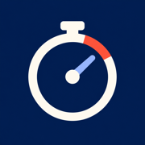
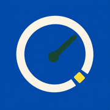

# Choose an iPhone Home Screen icon

JobTracker uses **Cutout**, a minimal J on a near-black background, by default.
On your own server, open the
app address followed by `/icons/index.html` in **Safari**. The gallery has a
separate installation page and downloadable PNG for each design.

| Design | Preview | Best fit |
| --- | --- | --- |
| Cutout · Default |  | A clean J with no extra marks; the default phone icon |
| 01 · Pace |  | Time and daily routines |
| 02 · Trace |  | Weight and measurements over time |
| 03 · Dial |  | A bold, warm clock face |
| 04 · Ledger |  | Goals and recorded progress |
| 05 · Marker |  | A compact measurement instrument |

## Apply a design

1. Open the **current** Home Screen app and let pending changes finish syncing.
2. In Safari, open your server's `/icons/cutout.html` to install **Cutout**.
   The gallery at `/icons/index.html` also includes the other designs.
3. On the selected design page, tap **Share → Add to Home Screen**. Keep
   **Open as Web App** enabled if your iOS version shows that switch.
4. Name it **JobTracker** and tap **Add**.
5. Launch the new icon. Enter your existing device token if asked and check
   that your saved history is present. Keep the old icon until this is confirmed.

The selected page provides its own Apple touch icon and manifest, while the
installed app opens the normal JobTracker screen. Both use the same own-server
API; the gallery makes no data requests. The 512px PNGs are also available from
each **Download PNG** link, and iPhone-specific 180px versions are included.

iOS may retain an icon chosen when the Home Screen item was added; deploying a
new image does not reliably replace an existing letter icon. Add the new item
from its installation page. Website/app storage may differ between installed
items, so do not clear website data or remove the old app while it has queued
writes. Signing into the same server loads the same synchronized history.

Apple documents [adding a website as a web app](https://support.apple.com/guide/iphone/iphea86e5236/ios)
and [how websites supply Home Screen icons](https://developer.apple.com/library/archive/documentation/AppleApplications/Reference/SafariWebContent/ConfiguringWebApplications/ConfiguringWebApplications.html).
Actual icon installation must be checked on an iPhone; desktop browser tests
verify the supplied metadata and layout, not iOS's Home Screen cache.

## Custom photo shortcut

Apple's Shortcuts app can also use a downloaded PNG as a Home Screen shortcut
icon. A shortcut that opens a URL may launch Safari instead of the standalone
web app, so the design-specific installation pages above are preferred for
JobTracker. See [Apple's custom shortcut icon guide](https://support.apple.com/guide/shortcuts/apd735880972/ios).

## Artwork

Cutout is drawn directly as [SVG geometry](../../web/icons/cutout.svg), with
512px and 180px PNG exports. Its source is the exact selected design. The five
other designs were created with the built-in image generation tool from
original briefs for geometric time, progress and measurement marks. All use
opaque square backgrounds so iOS can apply its own corner mask. These choices
customize the phone installation.
